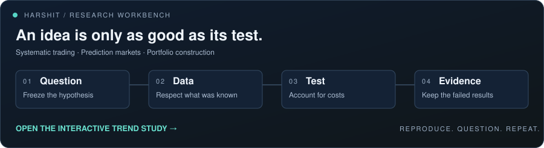

# Harshit Kumar

### Quantitative research · Systematic trading · Reproducible experiments

I test trading ideas with frozen hypotheses, point-in-time data, and costs included.

[Explore the research](#selected-research) &nbsp; / &nbsp; [Run an experiment](https://harshitk2814.github.io/riding-every-horizon/) &nbsp; / &nbsp; [How I work](#research-standards)

### Choose a research path

<strong>Run an experiment — trend following</strong>

Open the [interactive research site](https://harshitk2814.github.io/riding-every-horizon/) to rerun the historical backtest in your browser. Explore the [code and assumptions](https://github.com/HarshitK2814/riding-every-horizon), including costs, crisis behavior and the TimesFM extension.

<strong>Challenge a claim — prediction markets</strong>

Does a price of 20 cents mean a 20% chance? The [pre-registered Kalshi study](https://github.com/HarshitK2814/do-the-odds-hold) tests calibration and longshot bias. Milestone A found no evidence of overpricing below 15 cents at the seven-day horizon. [Inspect the results and confidence intervals](https://github.com/HarshitK2814/do-the-odds-hold/blob/main/research/results_milestone_a.md).

<strong>Follow the frictions — options and portfolio construction</strong>

Investigate [how changing a collar's reset day changes its outcome](https://github.com/HarshitK2814/collars-under-the-microscope), or [how costs, capacity limits and tax affect ML stock signals](https://github.com/HarshitK2814/Machine-Learning-for-Alpha-Signal-Combination-and-Portfolio-Construction). Historical simulations are presented with their limitations.

---

### Currently investigating

**Prediction markets** — Are event prices calibrated? Are longshots overpriced? Does fading them pay after fees and spreads?

**Milestone A is published:** calibration slope 0.87 (95% CI 0.78–0.96) across 3,170 markets. No evidence that contracts below 15 cents were overpriced at the pre-registered seven-day horizon. [Read the results](https://github.com/HarshitK2814/do-the-odds-hold/blob/main/research/results_milestone_a.md).

## Research in figures

Figures from the linked studies. Strategy curves are historical simulations, not real-money performance.

<table>
<tr><td width="50%" valign="top"> <strong>Trend following</strong> Historical growth of $1; original study specification.</td><td width="50%" valign="top"> <strong>Collar reset timing</strong> Same hedge rule, different reset days; locked 2020–23 test.</td></tr>
<tr><td width="50%" valign="top"> <strong>Prediction-market calibration</strong> Milestone A reliability diagram at the seven-day horizon.</td><td width="50%" valign="top"> <strong>ML portfolio capacity</strong> Capacity effects across mandate sizes in Germany, India and Japan.</td></tr>
</table>

[Reproduce the trend study](https://harshitk2814.github.io/riding-every-horizon/) · [Read the calibration results](https://github.com/HarshitK2814/do-the-odds-hold/blob/main/research/results_milestone_a.md)

## Selected research

| Project | Research question and evidence | Explore |
| :--- | :--- | :--- |
| **Riding Every Horizon** | Trend following across **39 futures markets**, with a contamination-controlled test of Google's TimesFM as a trading signal. Includes an ongoing forward test. | [Interactive study](https://harshitk2814.github.io/riding-every-horizon/) · [Code](https://github.com/HarshitK2814/riding-every-horizon) |
| **Collars Under the Microscope** | Reconstructed a $20bn fund's S&P 500 put-spread collar. Strikes matched within **0.34 percentage points across 28 quarters**. Changing only the reset day produced annual returns from 3.4% to 10.7%. | [Code and findings](https://github.com/HarshitK2814/collars-under-the-microscope) |
| **Who Is Your Peer?** | A stock-selection model using **15 characteristics** from point-in-time filings. Best portfolio: net Sharpe **0.68**, with a 95% confidence interval of -0.31 to 1.67. The result was not statistically significant. | [Code and findings](https://github.com/HarshitK2814/who-is-your-peer) |
| **Hedge or Not?** | Reconstructed a currency-hedging rule from three sentences in a prospectus: **0.92 correlation** with the live fund. | [Code and findings](https://github.com/HarshitK2814/hedge-or-not) |
| **Seven Engines** | Reconstructed **seven futures styles** from a fund's 10-K filing. | [Code and findings](https://github.com/HarshitK2814/seven-engines) |
| **Do the Odds Hold?** | Pre-registered Kalshi calibration study. Seven-day test: **3,170 markets across 981 events**; the cheap-contract overpricing hypothesis was not supported. | [Study and results](https://github.com/HarshitK2814/do-the-odds-hold) |
| **ML Signals, Costs and Capacity** | Measures trading costs, participation limits and capital-gains tax in **Germany, India and Japan, 2009–2019**. At a $1bn mandate, the executable decile portfolios had negative net Sharpe ratios in all three markets. | [Code and research](https://github.com/HarshitK2814/Machine-Learning-for-Alpha-Signal-Combination-and-Portfolio-Construction) |

### Research in development

[Systematic Equity Trading Research](https://github.com/HarshitK2814/quantitative-trading-research) — research infrastructure and a planned **simulated paper-trading** evaluation. The repository reports foundations complete and strategy results pending.

## Research standards

| Before testing | When reporting | When sharing |
| :--- | :--- | :--- |
| Pre-register hypotheses and lock the test period in code. | State costs and capacity; report Sharpe ratios with confidence intervals and sample counts. | Provide a command to reproduce published numbers and automated checks on every push. |

> Failed tests stay in the research record.

---

Research artifacts only. Historical simulations and forward tests should be read separately from real-money results. Not investment advice.